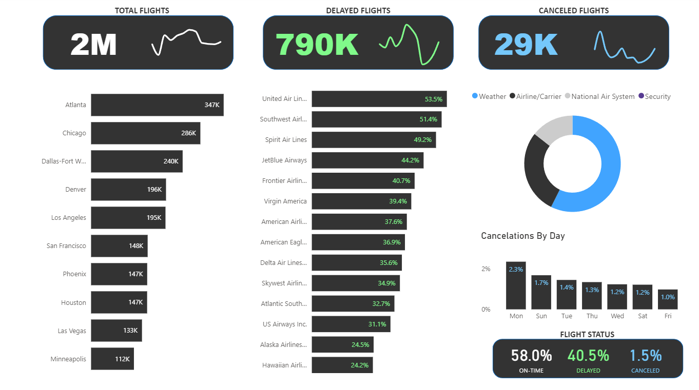

# US Flight Performance & Delay Analysis Dashboard

An end-to-end business intelligence and data analytics project analyzing over **2 million US flights** to evaluate carrier reliability, identify primary delay drivers, map airport congestion, and break down flight cancellation patterns.

---

## Dashboard Preview

### Main Operational Overview

### Data Architecture & Relational Model

---

## Project Overview & Objectives
The aviation industry operates on tight margins where delays and cancellations ripple across the entire national airspace network. The goal of this project was to ingest, model, and visualize large-scale flight performance data to answer key operational questions:
* **Which airlines and hubs experience the highest frequency of delays?**
* **What are the primary root causes behind flight cancellations (Weather, Carrier, NAS, Security)?**
* **How do cancellation and delay rates fluctuate across days of the week?**
* **What percentage of the national flight schedule operates on-time versus disrupted?**

---

## Data Modeling & Architecture
To ensure optimal query performance and clean measure calculations, the dataset was structured into a relational **star/snowflake schema** inside Power BI:
* **`flights` (Fact Table):** Contains granular transactional flight records, including departure delays, arrival statuses, routing, and foreign keys.
* **`airlines` (Dimension Table):** Maps carrier codes to full airline names (`1-to-Many` relationship).
* **`airports` (Dimension Table):** Captures geographic details including city, state, latitude, and longitude for origin/destination hubs (`1-to-Many` relationship).
* **`cancellation_codes` (Dimension Table):** Decodes specific categorical reasons for flight cancellations (`1-to-Many` relationship).

---

## Key Findings & Insights

* **Overall Network Health:** Out of ~2 million total flights analyzed, **58.0%** operated on-time, **40.5%** experienced delays (~790K flights), and **1.5%** resulted in outright cancellations (~29K flights).
* **Busiest Hubs:** Major hubs including **Atlanta (ATL)** (347K flights), **Chicago (ORD)** (286K flights), and **Dallas-Fort Worth (DFW)** (240K flights) handled the highest overall flight volumes.
* **Carrier Reliability & Delays:** Carrier delay rates varied significantly across airlines, with **United Airlines** showing a **53.5%** delay rate, **Southwest Airlines** at **51.4%**, and **Spirit Airlines** at **49.2%**.
* **Disruption Trends by Day:** Cancellation rates peak notably at the start of the week (**Monday at 2.3%**), gradually tapering off toward the weekend (**Friday at 1.0%**).
* **Cancellation Drivers:** Weather represents the primary driver of cancellations, followed by Airline/Carrier operational issues and National Air System (NAS) constraints.

---

## Tech Stack & Tools
* **Data Modeling & Transformation:** Power Query, Relational Schema Design, Primary/Foreign Key mapping.
* **Visualization & BI:** Power BI Desktop (Custom KPI cards, Donut charts, Bar distributions, Matrix design).
* **Version Control & Hosting:** GitHub Web Interface.

---

## How to Explore This Project
1. Download the `.pbix` file from this repository.
2. Open the file in **Power BI Desktop** to interact with cross-filtering and visual slicers.
3. Inspect the **Model View** to review table relationships and key cardinalities.
